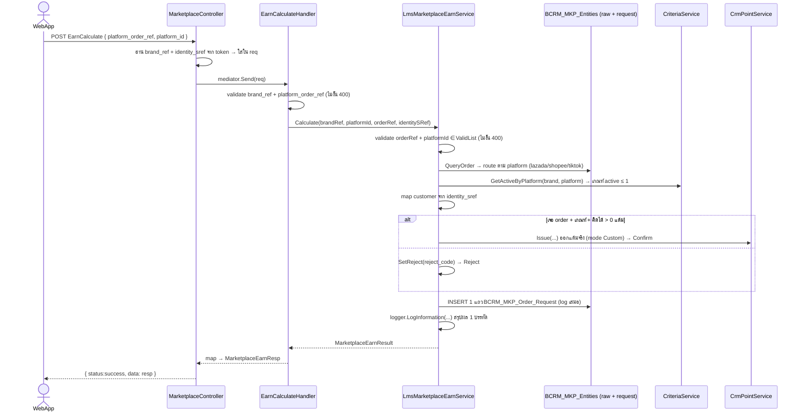

# API Spec — Marketplace Point Earn (Calculate)

กลับไป [[00-Overview]] · schema [[01-Schema]] · flow [[02-Flow]] · brief frontend [[06-Frontend-Brief]]

> [!warning] สถานะ: **ออกแต้มจริงแล้ว** (ไม่ใช่ preview)
> `status = 1 (Confirm)` = แต้มเข้า wallet ลูกค้าเรียบร้อยผ่าน `LmsCrmPointService.Issue`
> กันแต้มซ้ำที่ point service ด้วย `Ext_Transaction_Id = MKP-{platform_id}-{order_ref}` → order เดิมออกได้ครั้งเดียว
> รองรับ **lazada(1) / shopee(2) / tiktokshop(4)** · **linemyshop(3) ยังไม่ทำ** → ยิงมาจะ 400

## Endpoint
```
POST api/v1/internal/Marketplace/EarnCalculate
```
- Auth: `LmsAuthorize` (WebApp token) — `brand_ref` + `identity_sref` ดึงจาก token ไม่ต้องส่ง
- Controller: `LMS.App.Api/.../Internal/Marketplace/MarketplaceController.cs`
- Handler: `LMS.App.Application/.../Internal/Marketplace/MarketplaceEarnCalculateHandler.cs`
- Core service: `lms-core` → `Services/Marketplace/LmsMarketplaceEarnService.cs`
- **JSON casing:** WebApp ใช้ `LowerCaseNamingStrategyUtil` → property บน wire เป็น **ตัวพิมพ์เล็กทั้งหมด** (`platform_order_ref`, `total_point`, `reject_code`)

## การทำงาน (end-to-end)
ยิง 3 ชั้น: **Controller → Handler (MediatR) → Core service** — logic จริงอยู่ที่ core service ชั้นเดียว



**ลำดับใน `Calculate` (หัวใจ):**
1. **validate** — `platform_order_ref` ว่าง / `platform_id` นอก ValidList → โยน 400 **ก่อน** query (ยังไม่ log)
2. **query order** — `QueryOrder` route ตาม `platform_id` → normalize เป็น `MarketplaceOrderSnapshot`
   - lazada → `BCRM_MKP_Raw_lazada_order(_item)` · spending = Σ `paid_price` (THB เท่านั้น) · qty/SKU = นับแถว item
   - shopee → `BCRM_MKP_Raw_shopee_order(_item)` · spending + SKU จาก `item_list` (JSON) · qty = Σ `model_quantity_purchased`
   - tiktok → `BCRM_MKP_Raw_tik_tok_shop_order(_item)` · spending = Σ `sale_price` · qty/SKU = นับแถว (currency assume THB)
   - **linemyshop / อื่นๆ → throw 400** (ยังไม่ทำ) → throw ก่อนถึง insert = ไม่ log
3. **หาเกณฑ์** — `criteriaService.GetActiveByPlatform` คืนเกณฑ์ active ของ platform (≤ 1)
4. **map customer** — จาก `identity_sref` ที่ล็อกอิน → ไม่เจอ = null (ยังไปต่อได้ถ้าจะ reject)
5. **ตัดสิน + ออกแต้ม**
   - ไม่เจอ order → Reject `OrderNotFound(1)`
   - เจอ order แต่ไม่มีเกณฑ์ → Reject `NoActiveCriteria(2)`
   - เจอครบ → `MarketplaceEarnCalculator.Apply` (สูตรล้วน)
     - คิดได้ ≤ 0 → Reject `ZeroPoint(3)`
     - คิดได้ > 0 → `IssuePoint` **ออกแต้มจริง** → Confirm
       - ⚠️ ถ้า map customer ไม่เจอ ณ จุดนี้ → throw **1000404** (identity ล็อกอินมาแต่หา customer ไม่เจอ = ผิดปกติ)
6. **log DB** — `LogRequest` → INSERT 1 แถว `BCRM_MKP_Order_Request` **ทุกกรณีที่ผ่าน validate** → คืน `Request_Id`

> ⚠️ ลำดับสำคัญ: **ออกแต้มก่อน แล้วค่อย log** — แถว log มีทั้ง input + ผลคำนวณ + tx id ที่ออกจริง

## Request
```jsonc
{
  "platform_order_ref": "123456789",  // เลขออเดอร์ในระบบ marketplace (string) — ผู้ใช้กรอก
  "platform_id": 1                    // 1=lazada 2=shopee 3=linemyshop 4=tiktokshop
}
```
| Field | Type | Req | Note |
|---|---|:-:|---|
| `platform_order_ref` | string | ✓ | ใช้ query raw table |
| `platform_id` | int | ✓ | `LmsMarketplaceConst.Platform` · รับ `1/2/4` · `3` (linemyshop) ยัง 400 |

## Response
ห่อด้วย envelope มาตรฐาน: `{ "request_id", "status", "data" }`
- envelope `status` = `success`/`fail`/`error` → **request ผ่านไหม** (ไม่ได้แปลว่าได้แต้ม)
- ได้แต้มหรือไม่ ดูที่ `data.status` (int) → **ต้องเช็ค 2 ชั้น**

`data` (`MarketplaceEarnResp`):
```jsonc
{
  "requestid": 1024,                  // แถวที่ log ลง BCRM_MKP_Order_Request
  "platformid": 1,
  "platformcode": "lazada",
  "platform_order_ref": "123456789",

  "order_found": true,
  "order_number": "ON-2026-0001",
  "store_ref": null,
  "order_status": "delivered",        // lazada = token แรกจาก statuses
  "spending": 1250.00,

  "criteria_configid": 7,
  "criteria_name": "โปรกันยา ร้าน A",
  "point_by": 3,                      // bitmask (ดู [[../Marketplace-Point-Criteria/04-PointBy-Constant]])

  "fixed_point": 10,
  "spending_point": 20,
  "sku_point": 0,
  "total_point": 30,                  // ← แต้มที่ออกจริง ใช้โชว์ popup
  "sku_lines": [
    { "sku": "A", "qty": 5, "point": 10 }
  ],

  "status": 1,                        // 1=Confirm 2=Reject (ดู §Status)
  "status_desc": "Confirm",
  "reject_code": null,                // มีค่าเมื่อ status=2
  "reject_message": null              // ข้อความไทย โชว์ผู้ใช้ได้เลย
}
```

## Status (`data.status` = `LmsMarketplaceConst.EarnStatus`)
| code | Desc | เมื่อไหร่ | ออกแต้ม? |
|:-:|---|---|:-:|
| 1 | Confirm | เจอ order + เกณฑ์ + คิดได้ > 0 → ออกแต้มสำเร็จ | ✓ เข้า wallet แล้ว |
| 2 | Reject | ไม่ออกแต้ม — เหต���ผลที่ `reject_code` | – |

## Reject Code (`data.reject_code` = `LmsMarketplaceConst.RejectCode`, มีเมื่อ status=2)
| code | `reject_message` |
|:-:|---|
| 1 | ไม่พบ order ในระบบ marketplace |
| 2 | ไม่มีเกณฑ์ที่ใช้งานอยู่ของ platform นี้ |
| 3 | คิดแต้มได้ 0 (order ไม่เข้าเงื่อนไขให้แต้ม) |

> ทุกครั้งที่ยิง (Confirm/Reject) → **insert 1 แถว** `BCRM_MKP_Order_Request`

## Error (envelope `status: fail/error`, HTTP 400/404)
| กรณี | code | message |
|---|:-:|---|
| ไม่ส่ง `platform_order_ref` | 1000400 | ต้องระบุ platform_order_ref |
| `platform_id` นอก ValidList | 1000400 | platformId ไม่ถูกต้อง |
| platform ที่ยังไม่ทำ query (linemyshop) | 1000400 | ยังไม่รองรับการคิดแต้มของ platform นี้ |
| identity ล็อกอินมาแต่ map customer ไม่เจอ (ตอนจะออกแต้ม) | 1000404 | ไม่พบลูกค้าจาก identity ที่ล็อกอิน |
| point service ออกแต้มไม่สำเร็จ | 1000400 | ออกแต้มไม่สำเร็จ |

## สูตรคิดแต้ม (ตาม `point_by` bit — ดู [[../Marketplace-Point-Criteria/04-PointBy-Constant]])
```
Fixed    (bit 1): Fixed_Point + Extra_Point
Spending (bit 2): floor(Spending / Spending_Base) × Spending_Point
SKUs     (bit 4): ต่อ SKU ที่ซื้อ → floor(qty / Quantity) × Point_Per_Qty
Total = ผลรวมของ bit ที่เปิด (stack)
```
logic ล้วน (ไม่แตะ DB) อยู่ที่ `MarketplaceEarnCalculator.Apply` → เทสที่ `MarketplaceEarnCalculatorTest`

## Log — เก็บอะไร เก็บยังไง
มี log **3 ชั้น** จาก 1 request:

### 1) DB log — `BCRM_MKP_Order_Request` (ตัวหลัก, ถาวร)
- **เก็บทุกครั้ง** ที่ผ่าน validate — 1 request = **1 แถว** insert เสมอ (Confirm/Reject)
- insert ที่ `LogRequest` **หลังออกแต้มเสร็จ** → แถวเดียวมีทั้ง input + ผลคำนวณ + tx id
- ใช้ **DbContext ใหม่แยก** (ไม่ใช่ตัว query order) — insert อย่างเดียว, คืน `Request_Id`
- **dedupe แต้มซ้ำ** อยู่ที่ point service (`Ext_Transaction_Id`) ไม่ได้อยู่ตารางนี้ → ยิงซ้ำ order เดิม row log เพิ่มได้ แต่แต้มไม่ออกซ้ำ
- **ไม่ทำ soft delete** — เป็น log ไม่ลบ

**column ที่เขียน:**
| column | มาจาก | หมายเหตุ |
|---|---|---|
| `Request_Id` | identity (auto) | PK คืนใน resp (`requestid`) |
| `Brand_Ref` | token | |
| `Platform_Id` / `PlatformId_Desc` | input / `Platform.GetDesc` | เช่น `1` / `"lazada"` |
| `Platform_Order_Ref` | input | |
| `Order_Number` / `Shop_Ref` | order (ถ้าเจอ) | null ถ้าไม่เจอ |
| `Spending` / `Point_Amount` | ผลคำนวณ | **null ถ้าไม่เจอ order** |
| `Criteria_ConfigId` | เกณฑ์ที่ match | null ถ้าไม่มีเกณฑ์ |
| `Point_Calc` | `CalculationMode.Custom` | set เฉพาะ row ที่ออกจริง (Confirm); Reject = null |
| `Status` | `EarnStatus` (1/2) | |
| `Reject_Code` / `Reject_Message` | เหตุผล (ถ้า reject) | null ถ้า Confirm |
| `Request_Channel` | `RequestChannel.WebApp` (1) | |
| `Customer_Id` / `Identity_Id` | จาก customer ที่ map | null ถ้า map ไม่เจอ |
| `Buyer_Ref` | buyer id ฝั่ง platform | lazada=buyer_id, shopee=buyer_user_id, tiktok=user_id |
| `Ext_Transaction_Id` / `Point_TransactionId` | ผลออกแต้มจริง | set เฉพาะ Confirm |
| `Created_Time` / `Updated_Time` | `DateTime.Now` | |

> column ที่ยังไม่ใช้ (เช่น `Verify_Method`, `Approved_By`, `Void_TransactionId`, `Order_Time`) = เผื่อเฟสหลัง (void/approve) ตอนนี้ปล่อย null

### 2) App log — `logger.LogInformation` (1 บรรทัดสรุป)
```
Marketplace earn calc: platform=lazada order=123456789 status=Confirm point=30 req=1024
```
ไว้ไล่ดูเร็วๆ ใน console/log sink (ไม่ใช่ที่เก็บถาวร — audit ใช้ DB log)

### 3) HTTP log — `[LmsLogging]` attribute
`[LmsLogging(logHeader:true, logReq:true, logResp:true, reqKeys:["req"])]` — เก็บ header + req body + resp body ของ HTTP call นี้

### สรุปว่าเมื่อไหร่ "ไม่" ลง DB log
| กรณี | ลง `BCRM_MKP_Order_Request`? |
|---|:-:|
| Confirm (ออกแต้มสำเร็จ) | ✓ |
| Reject ทุกเหตุผล (order ไม่พบ / ไม่มีเกณฑ์ / 0 แต้ม) | ✓ |
| validate ไม่ผ่าน (order_ref ว่าง / platform ผิด) | ✗ throw ก่อน |
| linemyshop (query ยังไม่ทำ) | ✗ throw ก่อน |
| map customer ไม่เจอตอนจะออกแต้ม | ✗ throw 404 ก่อน insert |

## ยังไม่ทำ (seam มี `ponytail:` comment ในโค้ด)
- **linemyshop** query — เจ้าเดียวที่ยัง throw (มี header discount, ไม่มี currency, ไม่มี user_id → ผูก customer ไม่ได้)
- store/order-status **gating** — ยังไม่ enforce (1 platform = 1 active config เลยคิดตัวนั้นเลย) รอ payload hub จริง
- lazada/tiktok SKU qty = นับจำนวนแถว item (สมมติ 1 แถว = 1 ชิ้น)
- tiktok currency อยู่ใน `order.payment` (JSON) ยัง parse ไม่ได้ → assume THB
- lifecycle **Pending** — ยังไม่มี (ดู [[05-Decision-Status-vs-EarnResult]])
