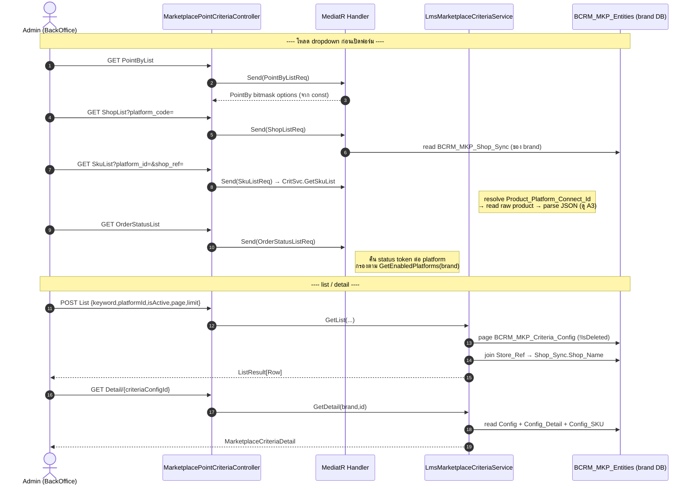
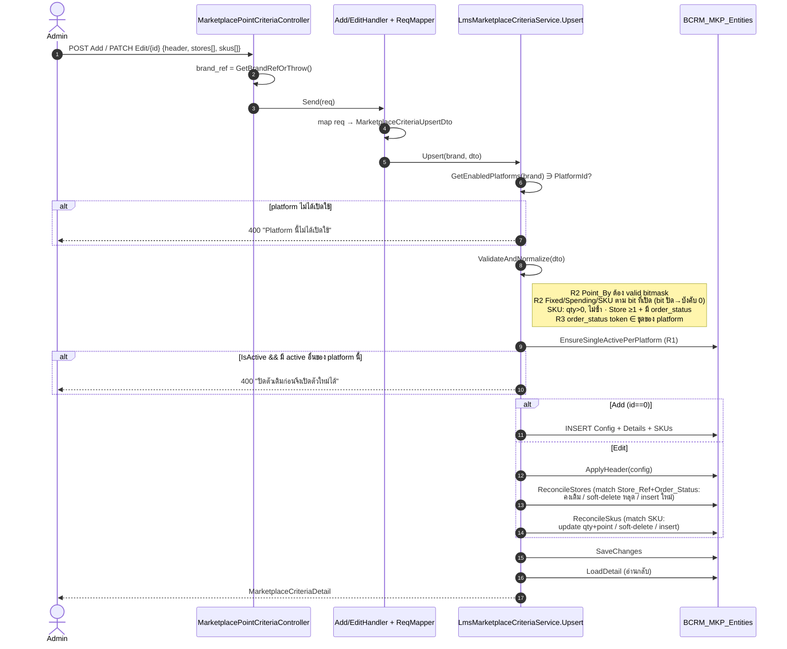
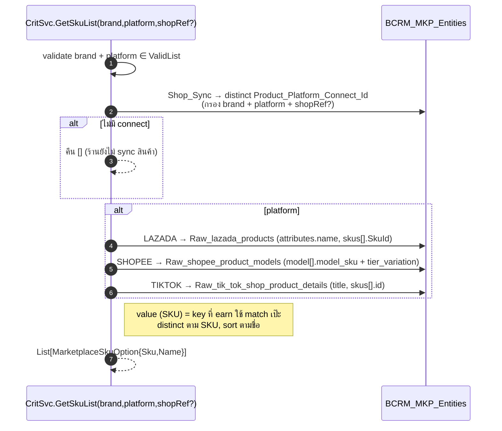
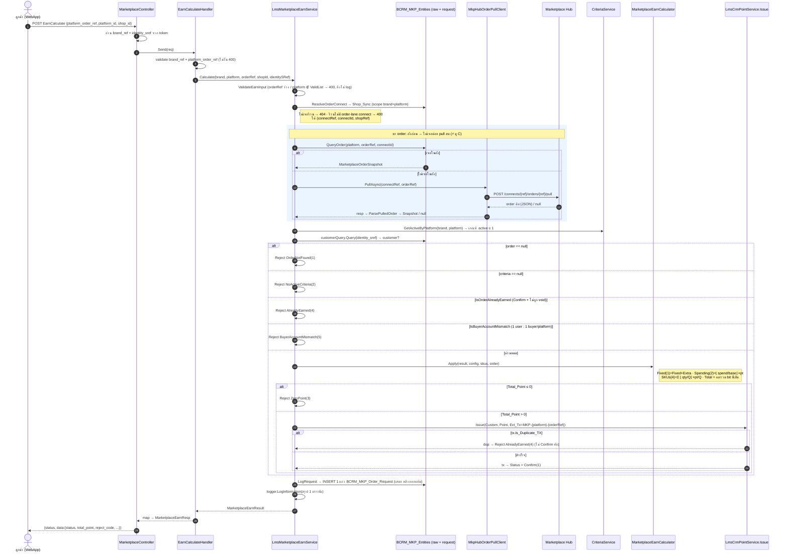
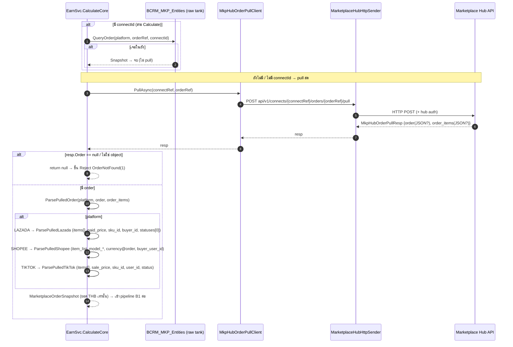

# Marketplace — Sequence Diagrams (Config Criteria + EarnPointByOrderId)

รวม sequence diagram ปัจจุบันของ 2 ขา marketplace point + ขา **realtime pull จาก hub**

- 🟦 **Config Criteria** — admin ตั้งเกณฑ์ให้แต้ม (lms-backend · `MarketplacePointCriteriaController`)
- 🟩 **EarnPointByOrderId** — ลูกค้ากดรับแต้มจาก order (core `LmsMarketplaceEarnService`)
- ⚡ **Realtime** — ดึง order สดจาก marketplace hub เมื่อถังยังไม่มี

อ้างอิงโค้ดจริง: `lms-core` `Choco.LMS.Core/Services/Marketplace/*` · `lms-backend` `LMS.Backend.{Api,Application}/.../Marketplace/*`

> ดูคู่กับ spec เดิม: [[../Marketplace-Point-Criteria/00-Overview]] · [[../Marketplace-Point-Earn/00-Overview]]

---

## ผู้เล่น (participants) ที่ใช้ร่วมกัน

| ชื่อย่อ | จริงๆ คือ | repo |
|---|---|---|
| `CritCtrl` | `MarketplacePointCriteriaController` | lms-backend |
| `CritHdlr` | MediatR handler (List/Detail/Add/Edit/Delete/…) | lms-backend |
| `CritSvc` | `ILmsMarketplaceCriteriaService` | lms-core |
| `EarnCtrl` | `MarketplaceController` (action `EarnCalculate`) | WebApp (LMS.App.Api) |
| `EarnHdlr` | `MarketplaceEarnCalculateHandler` | WebApp |
| `EarnSvc` | `ILmsMarketplaceEarnService` | lms-core |
| `Calc` | `MarketplaceEarnCalculator.Apply` (สูตรล้วน) | lms-core |
| `PointSvc` | `ILmsCrmPointService.Issue` | lms-core |
| `HubPull` | `IMkpHubOrderPullClient.PullAsync` | lms-core |
| `HUB` | Marketplace Hub (`platform-marketplace-hub`) | hub |
| `MKPDB` | `BCRM_MKP_Entities` (brand DB: raw order/product + config + order_request) | brand DB |

---

## (A) Config Criteria — CRUD

ทุก action เป็น `[LmsAuthorize]` → `brand_ref` ดึงจาก token (`GetBrandRefOrThrow`) · controller บาง, logic อยู่ core ชั้นเดียว

### A1. ภาพรวม endpoint ทั้งชุด

### A2. Add / Edit (Upsert) — กฎ validate R1–R4

`Upsert` ใช้ทั้ง Add (`Criteria_ConfigId == 0` → insert) และ Edit (reconcile ตาม natural key)

> `Grand_Total_Point = Fixed + Extra` เท่านั้น — ส่วน Spending/SKU คิดตอน **earn** ไม่ได้ freeze ที่ config
> Audit เขียน `Req_IdentityId` / `Req_Identity_SRef` จาก `IdentityContext.Current`

### A3. SkuList dropdown — แกะ SKU จาก raw product (ต้องตรงกับที่ earn match)

---

## (B) EarnPointByOrderId — ลูกค้ากดรับแต้ม

entry 2 ทางใน `LmsMarketplaceEarnService`:
- **`Calculate(brand, platform, orderRef, shopId, identitySRef)`** — เลือกร้าน → resolve connect → **หาในถังก่อน** ไม่เจอค่อย pull สด
- **`CalculateByConnect(brand, platform, orderRef, connectRef, identitySRef)`** — ข้ามถัง → **pull สดจาก hub ตรงๆ** (ขา realtime ล้วน)

ทั้งคู่วิ่งลง `CalculateCore` pipeline เดียวกัน

### B1. Flow เต็ม (Calculate → ถังก่อน, ไม่เจอ pull)

> ⚠️ ลำดับสำคัญ: **ออกแต้มก่อน → แล้วค่อย log** (แถว log มี input + ผลคำนวณ + tx id ครบ)
> ⚠️ customer == null ตอนจะ `IssuePoint` → throw **1000404** (identity ล็อกอินมาแต่ map customer ไม่เจอ = ผิดปกติ, ไม่ log ว่าออกสำเร็จ)

### B2. เช็ค 2 ชั้นที่ฝั่ง client ต้องอ่าน

| ชั้น | field | ความหมาย |
|---|---|---|
| envelope | `status` = success/fail/error | request ผ่าน/ไม่ผ่านเท่านั้น |
| data | `data.status` = 1 Confirm / 2 Reject | ได้แต้มจริงไหม |
| data | `data.reject_code` (1–5) | เหตุผลเมื่อ Reject |

Reject code: `1` order ไม่พบ · `2` ไม่มีเกณฑ์ active · `3` คิดได้ 0 แต้ม · `4` รับแต้มไปแล้ว · `5` buyer ไม่ตรงบัญชีที่ผูก

---

## (C) ⚡ Realtime — pull order สดจาก hub

หัวใจของขา realtime: เมื่อ order **ยังไม่ถูก ingest เข้าถังเรา** `EarnSvc` ดึงสดจาก marketplace hub ทีละ connect แล้วแกะเป็น snapshot เดียวกับขาถัง → คิดแต้มต่อได้เลย

**จุด trigger 2 แบบ:**
1. `Calculate` → `QueryOrder` คืน `null` (ถังไม่มี) → fallback `PullOrder`
2. `CalculateByConnect` → `connectId = null` → **ข้ามถังเลย** ดึงสดอย่างเดียว

**หมายเหตุ realtime (ponytail ในโค้ด):**
- hard **THB เท่านั้น** — item สกุลอื่นถูกข้าม (ยังไม่มี multi-currency)
- hub ยก `order_items` ขึ้น top-level array ให้แล้ว แต่ field ในแต่ละ item ยังต่างตาม platform
- **shopee** shape ยังเดาจาก entity DB (รอ resp จริงยืนยัน); lazada/tiktok ยืนยันแล้ว
- **linemyshop** ยังไม่รองรับทั้ง query และ pull → throw `1000501` "ยังไม่รองรับ"
- `IMkpHubOrderPullClient` resolve แบบ lazy จาก DI (`di.GetService`) — host ที่ไม่ได้ต่อ hub จะ throw `1000501` ตอนเรียก ไม่ใช่ตอน startup

---

## สรุปการ gating ที่ **ยังไม่** enforce (อ่านก่อนตรวจว่าแต้มถูก)

- **store + order-status gating** ตอน earn ยัง **ไม่** enforce — 1 platform มี active config เดียว เลยคิดจากตัวนั้นเลย (รอ payload hub จริงมาแจกแจง)
- ดังนั้น `Config_Detail.Order_Status` ที่ตั้งไว้ฝั่ง config **ยังไม่ถูกเทียบ** ตอนคิดแต้ม
- lazada/tiktok qty ต่อ SKU = นับจำนวนแถว item (สมมติ 1 แถว = 1 ชิ้น)
- tiktok currency อยู่ใน `order.payment` JSON ยัง parse ไม่ได้ → assume THB

ดูเพิ่ม [[../Marketplace-Point-Earn/04-Store-Gating-ยังไม่-enforce]]
